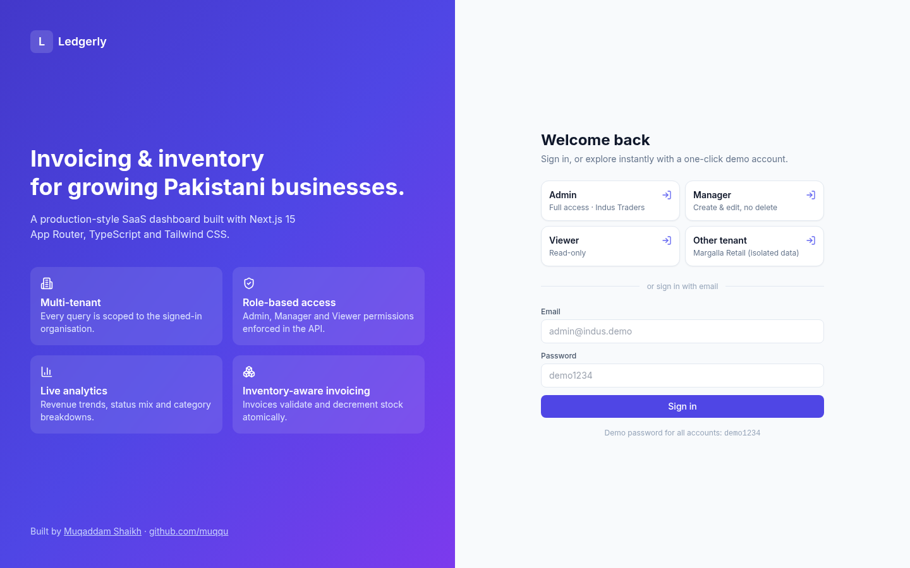
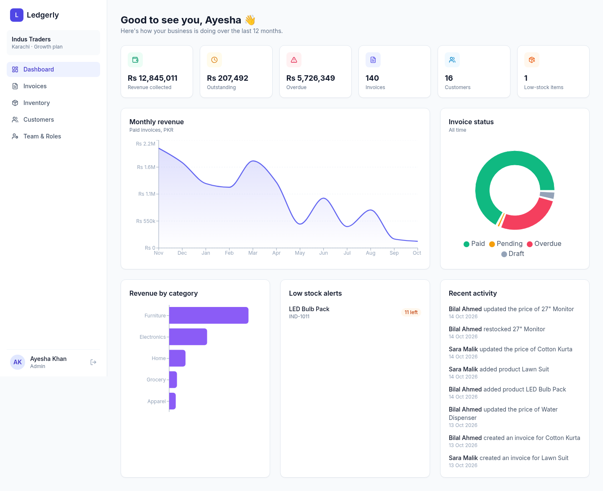
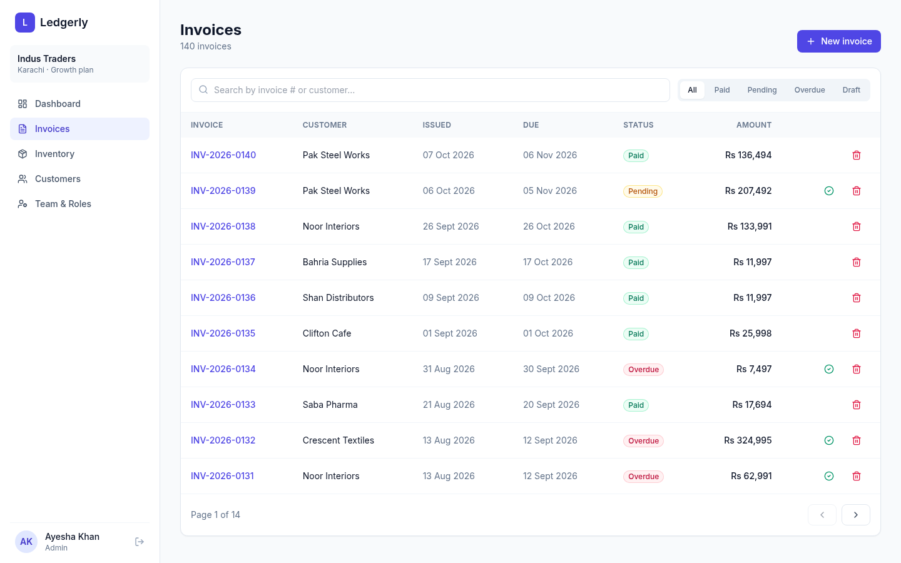
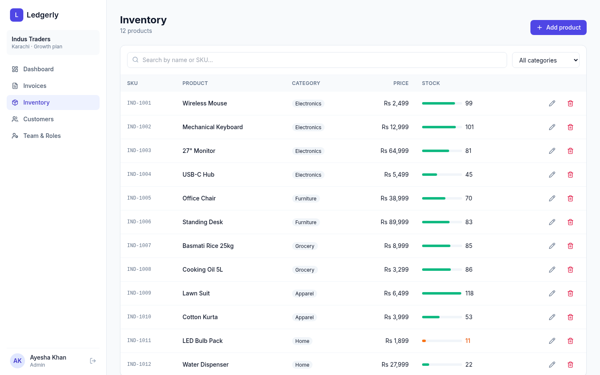

# Ledgerly — Multi-tenant Invoicing & Inventory SaaS

A production-style SaaS dashboard for small and mid-sized businesses: invoicing, inventory, customers and analytics, with **multi-tenancy** and **role-based access control**. Built by **Muqaddam Sheikh** ([muqaddamshaikh.site](https://www.muqaddamshaikh.site/) · [github.com/muqqu](https://github.com/muqqu)).

**Live demo:** https://ledgerly-saas-orcin.vercel.app · **Repo:** https://github.com/Muqqu/ledgerly · **Backend rewrite (.NET 8):** https://github.com/Muqqu/ledgerly-api

## One-click demo accounts
The login page has buttons for each one. The password for every account is `demo1234`.

| Role | Email | Tenant | Can do |
|---|---|---|---|
| Admin | admin@indus.demo | Indus Traders (Karachi) | Everything, including delete and the Team page |
| Manager | manager@indus.demo | Indus Traders | Create and edit, no delete |
| Viewer | viewer@indus.demo | Indus Traders | Read-only |
| Admin | admin@margalla.demo | Margalla Retail (Islamabad) | Separate tenant with its own data |

## Features
- **Auth:** HMAC-SHA256 signed, httpOnly session cookies (8h expiry), constant-time signature check, server-side route protection in the App Router layout.
- **RBAC:** one permission matrix (`lib/auth.ts`) drives both the API guards (403 responses) and the UI (hidden actions, admin-only pages).
- **Multi-tenancy:** every query is scoped by `tenantId` from the session, so tenants cannot read or change each other's data.
- **Dashboard:** KPI cards, a 12-month revenue area chart, an invoice status donut, revenue by category, low-stock alerts and an activity feed (Recharts).
- **Invoices:** debounced search, status tabs, server-side pagination, a multi-line invoice builder with live totals, mark as paid, delete (admin only). Creating an invoice checks stock and **decrements inventory**.
- **Inventory:** product CRUD, stock-level bars, category and low-stock filters.
- **Customers:** lifetime revenue and outstanding balance aggregated per customer, plus an add-customer form with validation.
- **Team & Roles:** an admin-only members list and permission matrix.
- **Audit log:** every write is recorded in the activity feed.
- **Responsive UI:** Tailwind CSS with shadcn-style primitives and a mobile drawer sidebar.

## Tech stack
Next.js 15 (App Router, Server Components, Route Handlers) · React 19 · TypeScript (strict) · Tailwind CSS · Recharts · lucide-react · deployed on Vercel.

## Architecture
```
app/
  page.tsx               landing + login (one-click demo)
  (app)/layout.tsx       server-side session gate + app shell
  (app)/dashboard|invoices|products|customers|team
  api/
    auth/login|logout    issue / clear the signed cookie
    invoices[/id]        GET (search, filter, paginate) · POST · PATCH · DELETE
    products[/id]        GET · POST · PATCH · DELETE
    customers            GET (with aggregates) · POST
    stats · team         dashboard data · admin-only member list
lib/
  auth.ts   sign/verify session + RBAC matrix
  api.ts    guard(permission) helper for route handlers
  db.ts     deterministic seeded data store (repository layer)
  stats.ts  analytics aggregation
```
The data layer sits behind `lib/db.ts`, so it can be swapped for Postgres or MySQL (Prisma, Drizzle, or a Laravel API backend) without touching the routes or the UI. The demo uses a deterministic in-memory seed (2 tenants, 210 invoices, 24 products, 26 customers), so it runs on Vercel with no database or paid services. Changes last only while the server instance is warm, and the demo resets itself to clean data.

## Screenshots
| Login | Dashboard |
|---|---|
|  |  |
| Invoices | Inventory |
|  |  |

## Run locally
```bash
npm install
npm run dev   # http://localhost:3000
npm run build && npm start
```
Optional: set `AUTH_SECRET` to override the session signing key.
